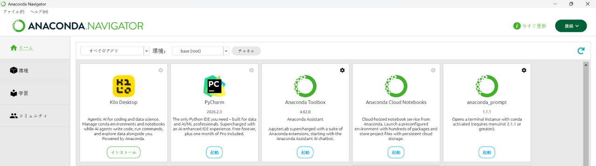
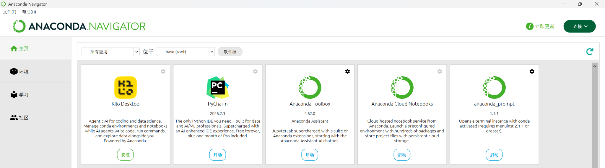

[简体中文](README.md) | [日本語](README.ja.md)

NavigatorL10n は、Windows 版 Anaconda Navigator の画面を日本語または簡体字中国語に変更するローカライズツールです。Navigator 本体の Python ソースコードにパッチを適用し、メニュー、ボタン、設定画面、ダイアログ、操作時のメッセージを翻訳します。

対応バージョンは **Anaconda Navigator 2.7.1 / 2.7.4（Windows）** です。

## 画面プレビュー

### 日本語



### 简体中文




## 対応言語と翻訳範囲

| 言語 | コード | 指定方法 |
| --- | --- | --- |
| 日本語 | `ja_JP` | `--lang ja_JP` |
| 簡体字中国語 | `zh_CN` | `--lang zh_CN`（デフォルト） |

この言語設定は Navigator の画面に適用されます。NavigatorL10n のコマンドラインメッセージは現在、中国語で表示されます。

主な翻訳対象：

- ホーム、環境管理、学習、コミュニティ
- パッケージの絞り込み、インストール、更新、削除
- 環境の作成、複製、削除、インポート、バックアップ
- アカウントへのサインイン、チャネル管理、環境設定
- 起動時の進行状況、操作ステータス、エラーや確認ダイアログ

パッケージ名、アプリ名、外部サービスが提供する説明文、オンライン講座やドキュメントの本文は原文のまま表示されます。

## インストールと使い方

[Releases](https://github.com/Olionly24601/NavigatorL10n/releases) からソースコードをダウンロードして展開します。**Anaconda Prompt** を開いて NavigatorL10n のフォルダーに移動し、対象の Navigator がインストールされている Conda 環境を有効にしてください。

Navigator が `base` 環境にある場合は、次のコマンドを実行します。

```cmd
conda activate base
```

別の環境にインストールされている場合は、その環境を有効にします。以降のコマンドは NavigatorL10n のフォルダー内で実行してください。

### 1. 対応状況を確認する

```cmd
python main.py check --lang ja_JP
```

現在の Conda 環境にある Navigator のバージョンと、パッチを適用するソースコードの一致を確認します。

### 2. 日本語化する

**Anaconda Navigator を完全に終了してから**実行します。

```cmd
python main.py apply --lang ja_JP
```

完了後に Navigator を起動し直すと、日本語の画面になります。

簡体字中国語を適用する場合は、代わりに次のコマンドを使用します。

```cmd
python main.py apply --lang zh_CN
```

`--lang` を省略した場合は簡体字中国語が選択されます。

### 3. 適用状態を確認する

```cmd
python main.py status
```

### 4. 英語の画面に戻す

Navigator を終了し、次のコマンドを実行します。

```cmd
python main.py restore
```

再起動すると元の英語表示に戻ります。

### 5. 言語を切り替える

日本語と簡体字中国語を切り替えるときは、Navigator を終了して `restore` を実行し、続けて変更先の言語を指定して `apply` を実行してください。最後に Navigator を再起動します。

## バックアップと復元

- パッチの適用前に元のソースファイルを保存します。
- プロジェクト内の `state/` フォルダーは削除しないでください。適用履歴と復元用バックアップが保存され、Conda 環境ごとに管理されます。
- Navigator を更新または再インストールする前に `restore` を実行してください。
- すでにパッチが適用されている場合は `status` で確認できます。別の言語を適用する場合は、先に元の状態へ復元します。
- ファイルの変更や復元エラーが発生した場合は、原因を解消してから復元を再実行してください。復元用データは `state/` に保持されます。

## 開発と翻訳

主要なファイル：

- `locales/zh_CN.json`、`locales/ja_JP.json`：共通の翻訳データ
- `patches/2.7.1.json`、`patches/2.7.4.json`：Navigator のバージョン別パッチルール
- `core/engine.py`：パッチの適用、確認、復元
- `tools/build_rules.py`：ルールの検証とメンテナンス

日本語の翻訳データとルールを検証する場合：

```cmd
python tools/build_rules.py validate --lang ja_JP
```

簡体字中国語の場合：

```cmd
python tools/build_rules.py validate --lang zh_CN
```

現在の Conda 環境にインストールされた Navigator に対して、ソースコードの照合と生成コードの Python 構文を検証する場合：

```cmd
python tools/build_rules.py verify --lang ja_JP
```

`--version 2.7.4` でバージョンを指定することもできます。ソースコードの検証では、指定したバージョンが実際のインストールと一致している必要があります。

新しい翻訳ルールを追加するときは `python tools/build_rules.py add <ルール定義.json>` を使用します。ルール定義には日本語と簡体字中国語の両方の翻訳を用意してください。

テストの実行：

```cmd
python -m unittest discover -s tests -v
```

翻訳の誤り、表示の不具合、対応バージョンに関する報告は [Issues](https://github.com/Olionly24601/NavigatorL10n/issues) からお願いします。

## プロジェクトについて

NavigatorL10n は独立してメンテナンスされている Anaconda Navigator のローカライズプロジェクトです。Anaconda Navigator および関連する名称・ロゴの権利は、それぞれの権利者に帰属します。

## ライセンス

NavigatorL10n の独自コードは [MIT License](LICENSE) で公開しています。
