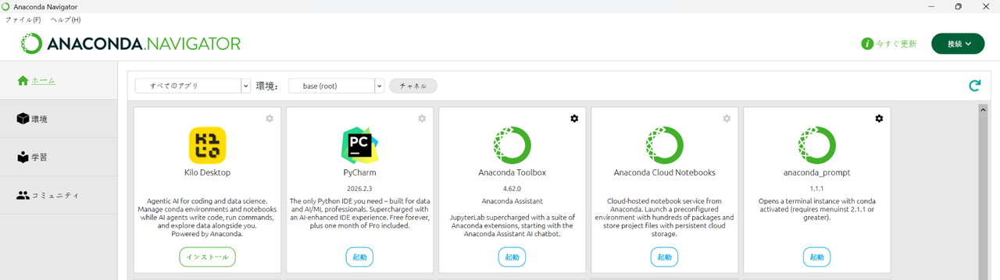

[简体中文](README.md) | [日本語](README.ja.md)

NavigatorL10n 为 Windows 版 Anaconda Navigator 提供简体中文和日语界面，通过源码补丁翻译 Navigator 的菜单、按钮、设置、弹窗和操作提示。

支持 **Anaconda Navigator 2.7.1、2.7.4（Windows）**。

## 日语界面预览



## 语言与翻译范围

| 语言 | 代码 | 安装参数 |
| --- | --- | --- |
| 简体中文 | `zh_CN` | `--lang zh_CN`（默认） |
| 日本語 | `ja_JP` | `--lang ja_JP` |

这里的语言选项控制 Navigator 界面；NavigatorL10n 自身的命令行提示目前使用中文。

目前覆盖的主要界面包括：

- 首页、环境管理、学习与社区
- 软件包筛选、安装、更新与卸载
- 环境创建、克隆、删除、导入与备份
- 账户登录、渠道管理、首选项与配置窗口
- 启动进度、操作状态、常见错误和提示弹窗

软件包及应用名称、第三方软件介绍、在线课程与文档内容保留原文。

## 安装与使用

从 [Releases](https://github.com/Olionly24601/NavigatorL10n/releases) 下载项目源码并解压。打开 **Anaconda Prompt**，进入 NavigatorL10n 目录，激活装有目标 Navigator 的 Conda 环境。如果 Navigator 安装在 `base`，执行：

```cmd
conda activate base
```

如果安装在其他环境，请激活对应环境。以下命令均在 NavigatorL10n 项目目录中执行。

### 1. 检查兼容性

安装日语界面：

```cmd
python main.py check --lang ja_JP
```

安装简体中文界面：

```cmd
python main.py check --lang zh_CN
```

工具会识别当前环境中的 Navigator 版本，并检查原始源码是否与该版本的补丁规则匹配。

### 2. 应用语言补丁

完全退出 Anaconda Navigator 后，执行需要的语言命令。

日语：

```cmd
python main.py apply --lang ja_JP
```

简体中文：

```cmd
python main.py apply --lang zh_CN
```

重新启动 Navigator，语言补丁即生效。省略 `--lang` 时默认使用简体中文。

### 3. 查看状态

```cmd
python main.py status
```

### 4. 恢复原版

关闭 Navigator，执行：

```cmd
python main.py restore
```

恢复完成后重新打开 Navigator，即可使用原始英文界面。

### 5. 切换语言

从中文切换到日语，或从日语切换到中文时，先退出 Navigator 并运行 `restore`，再执行所需语言的 `apply` 命令。切换后重新启动 Navigator。

## 备份与恢复

- 应用语言补丁前，工具会保存被修改文件的原始内容，并记录安装状态。
- 请保留项目中的 `state/` 目录；安装记录和恢复备份保存在这里，不同 Conda 环境分别管理。
- 更新或重新安装 Navigator 前，先执行 `restore`。
- 如果遇到已有安装记录，使用 `status` 查看当前状态；切换语言前先恢复原版。
- 写入和恢复过程中会检查文件变化。操作中断或恢复失败时，保留 `state/` 中的数据，排除问题后重新执行恢复。

## 项目开发

主要文件：

- `locales/zh_CN.json`、`locales/ja_JP.json`：两版共用的中文和日语翻译
- `patches/2.7.1.json`、`patches/2.7.4.json`：对应 Navigator 版本的源码匹配和替换规则
- `core/engine.py`：安装、检查和恢复逻辑
- `tools/build_rules.py`：规则校验、源码验证与规则维护

验证两个版本的中文规则：

```cmd
python tools/build_rules.py validate --lang zh_CN
```

验证日语规则：

```cmd
python tools/build_rules.py validate --lang ja_JP
```

在已激活的 Navigator 环境中检查源码匹配与生成代码的 Python 语法：

```cmd
python tools/build_rules.py verify --lang ja_JP
```

使用 `--version 2.7.4` 可针对指定版本执行校验；源码验证时，该版本须与当前环境实际安装的 Navigator 一致。

新增规则使用 `python tools/build_rules.py add <规则草稿.json>`，规则草稿需要同时提供两种语言的译文，构建工具会同步维护语言包和版本规则。

运行自动化测试：

```cmd
python -m unittest discover -s tests -v
```

翻译问题、界面显示异常和版本兼容性反馈可通过 [Issues](https://github.com/Olionly24601/NavigatorL10n/issues) 提交。

## 关于项目

NavigatorL10n 是独立维护的 Anaconda Navigator 本地化项目。Anaconda Navigator 及相关名称、标识归各自权利人所有。

## 许可证

NavigatorL10n 自行编写的代码采用 [MIT License](LICENSE)。
